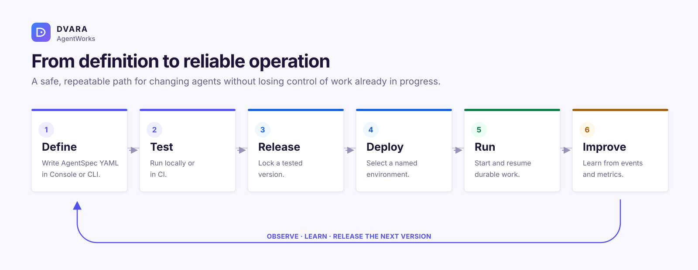
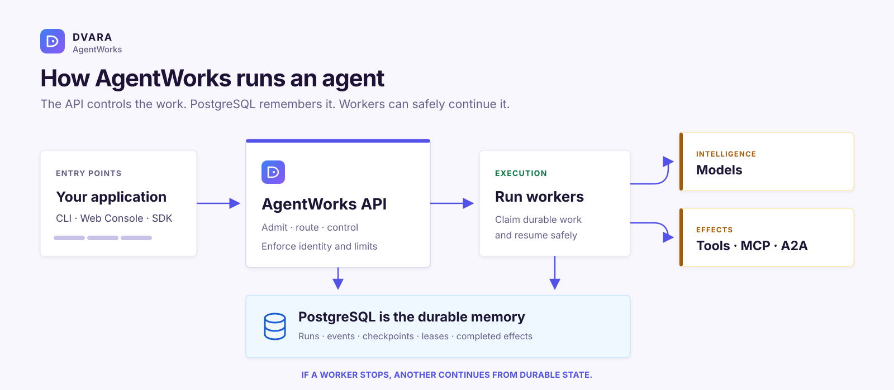

<p align="center">
  <a href="https://dvarahq.com"></a>
</p>

<h1 align="center">DVARA AgentWorks</h1>

<p align="center">
  An open-source durable runtime for building and operating production-grade enterprise agents.
</p>

<p align="center">
  <a href="docs/README.md">User docs</a> ·
  <a href="docs/getting-started.md">Get started</a> ·
  <a href="https://github.com/dvarahq/dvara-agentworks/issues">Issues</a> ·
  <a href="https://github.com/dvarahq/dvara-agentworks/releases">Releases</a>
</p>

<p align="center">
  <a href="https://github.com/dvarahq/dvara-agentworks/actions/workflows/core-ci.yml"></a>
  <a href="https://github.com/dvarahq/dvara-agentworks/releases"></a>
  <a href="LICENSE"></a>
</p>

---

## What is AgentWorks?

**DVARA AgentWorks is an enterprise AI agent runtime.** It runs complete AI agents—not just individual model calls—
and keeps their work safe while they use models, tools, other agents, people, and scheduled tasks.

AgentWorks does not replace your models or tools. It coordinates them and remembers the agent's progress in
PostgreSQL. If a server or worker stops, the work can continue from a safe point instead of starting over or silently
repeating a completed action.

## Why use it?

AI demos are easy. Running agents reliably is not. Agents call models, tools, and other agents, pause for people,
fail halfway through work, and change over time. AgentWorks gives that work a durable home.

Use AgentWorks when you want to:

- **survive restarts** without losing a run or repeating a completed action;
- **release changes safely** while older runs finish on the version they started with;
- **understand what happened** through events, checkpoints, audit records, and traces;
- **set limits** on time, model calls, tool calls, tokens, and cost;
- **bring your own models, tools, and agents** instead of locking your agent to one provider;
- **manage multiple agents in one installation** through one REST API, CLI, and Web Console.

Multiple agent definitions and their runs can share one open-source AgentWorks installation. This does not mean
multi-cluster fleet management or built-in agent-team orchestration.

## Example: a claims agent

Imagine a claims agent that reads a form, checks a policy, asks a person to approve a payment, and then calls a
payment tool.

Without durable execution, a crash can lose the approval or repeat the payment. With AgentWorks, each step is
recorded. The agent resumes from the safe point, and a completed external action is not silently repeated.

You can update and release a better version while older claims finish safely on the version they started with.

## Features

| What you need | What AgentWorks provides |
|---|---|
| Agent runs that survive failure | Durable runs, checkpoints, recovery, wakeups, and human interactions |
| Safe changes | Versioned agent definitions, immutable releases, controlled deployment, and rollback |
| Models, tools, and other agents | OpenAI-compatible models, Java and HTTP tools, MCP, and A2A |
| Security and cost control | Permissions, credentials by reference, admission limits, and run budgets |
| Confidence before release | Deterministic tests, simulation, evaluation, and replay |
| Production operations | REST API, CLI, Web Console, events, metrics, traces, Compose, and Helm |

## How it works

AgentWorks uses five concrete steps:

| Step | What you do | Where you do it |
|---|---|---|
| **1. Define** | Write an AgentSpec YAML file with the model, instructions, tools, and limits. A basic model-driven agent needs no Java code. Custom tools and executors do require code or an external service. | Web Console, CLI, or REST API |
| **2. Test** | Run deterministic agent tests and evaluations before publishing. | Locally or in CI with the Java test kit and evaluation API/CLI |
| **3. Release** | Build a release from a tested agent version. A release is a locked snapshot: it cannot change after it is created. A change creates a new version and release. | Web Console, CLI, or REST API |
| **4. Deploy** | Select a release for a named environment such as development, staging, or production. AgentWorks records which release should receive new work; it does not provision your cloud account. | Inside your AgentWorks installation, running with Compose or Kubernetes |
| **5. Run** | Start a run and inspect its events. Workers execute it, while PostgreSQL stores its progress so another worker can continue after a failure. | REST API, CLI, or Web Console |

New runs use the currently deployed release. Work already in progress stays with the release it started with, even
after you deploy a newer one.



AgentWorks stores the important state in PostgreSQL. Workers can stop and restart; another compatible worker can
continue from the recorded checkpoint.



## Try it locally

You need JDK 25, Docker, Git, and a Mac or Linux machine. The guided journey uses a built-in test model, so it does
not need a paid AI account:

```bash
./mvnw -B -ntp -Pjourney -pl agentworks-journey -am verify
```

The first run downloads dependencies and may take a few minutes. A successful run ends with `BUILD SUCCESS`.

Continue with the [15-minute guide](docs/getting-started.md) to start the Web Console and connect a real model.

## Is it a good fit?

AgentWorks is useful for agents that do real work: multi-step workflows, human approval, scheduled work, tool use,
or tasks that must survive failure. A small stateless chatbot may not need this much machinery.

The `1.0.0-rc5` release is still a release candidate. Read the [known limitations](docs/limitations.md) before using
it in production.

## Learn more

- [Getting started](docs/getting-started.md)
- [Core ideas in plain language](docs/concepts.md)
- [Write an AgentSpec](docs/agentspec.md)
- [Connect models and tools](docs/integrations.md)
- [Production checklist](docs/operations/production.md)
- [All user documentation](docs/README.md)

## Contributing and security

See [CONTRIBUTING.md](CONTRIBUTING.md) to contribute. Report product problems through
[GitHub issues](https://github.com/dvarahq/dvara-agentworks/issues). Report security problems privately as described
in [SECURITY.md](SECURITY.md); never put credentials or customer data in an issue.

## Licence

Copyright 2026 DVARA Labs Inc. Licensed under the [Apache License 2.0](LICENSE). See [NOTICE](NOTICE).
