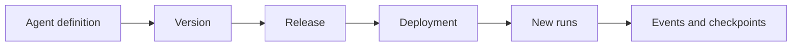

# AgentWorks concepts in plain language

AgentWorks separates **what an agent should do** from **work already in progress**. This lets you improve an agent
without silently changing a run halfway through.

## The five things to know

1. **Agent definition** — the editable name and home of an agent.
2. **Agent version** — a saved, unchangeable copy of its instructions and settings.
3. **Release** — a version plus the exact model, tools, policies, and runtime it needs.
4. **Deployment** — the release currently chosen for new work.
5. **Run** — one durable piece of work, permanently linked to the release that started it.

## What happens when you deploy a new version?

Suppose release R1 is running and you promote R2:

- new runs go to R2;
- existing R1 runs stay on R1;
- R1 enters `DRAINING`, which means it accepts no new work but can finish old work;
- R1 can retire after all of its work is finished or safely resolved.

AgentWorks never swaps R2 into the middle of an R1 run. That is what makes long-running work predictable.

## New work and continued work

A **root** is new work, such as a new API request or scheduled job. It uses the currently deployed release.

A **continuation** resumes existing work, such as a retry, callback, human response, child result, or scheduled
wakeup. It keeps the same release and security context as the run it belongs to.

## Why PostgreSQL matters

PostgreSQL is the source of truth for runs, events, checkpoints, leases, deadlines, and lifecycle decisions. Workers
can be replaced because they do not own that state. PostgreSQL time—not a worker's local clock—decides leases and
deadlines consistently across the cluster.

## Safe retries

Important write requests use **idempotency** keys. Repeating the same request with the same key returns the original
result instead of doing the work twice. Reusing the key with different content is rejected.

This is especially important for model calls, tools, payments, emails, and other effects that should not be repeated
by accident.

## When an old release will not finish

Use the Console, CLI, or API to see what is blocking retirement. You can:

- wait for healthy work to finish;
- suspend a cohort while you investigate;
- cancel work only when cancellation can be recorded truthfully;
- revoke unsafe work while keeping evidence of anything already attempted;
- retire only when AgentWorks reports no remaining blockers.

For version support and upgrade rules, see [Compatibility](operations/compatibility.md).
