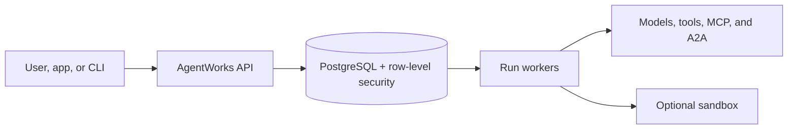

# AgentWorks threat model

This is a practical summary of what AgentWorks protects, where trust changes, and which responsibilities remain with
the operator.

## What we protect

The important assets are workspace data, credentials and delegated grants, agent releases, durable run history,
artifacts, control-plane authority, worker claims and effects, and the host running AgentWorks.

Requests, uploaded content, model output, tool output, webhooks, URLs, archive names, and integration responses are
untrusted input. A client-provided workspace or run identifier is not proof of authority. AgentWorks rebuilds
authority from the authenticated identity and durable PostgreSQL state.

## Main risks and controls

| Risk | How AgentWorks reduces it |
|---|---|
| One workspace reads another | Deny-by-default authorization, principal-derived workspace scope, and PostgreSQL RLS. |
| A stolen credential causes damage | Credential references, just-in-time resolution, narrow scopes, expiry, and rotation. |
| A repeated request performs an effect twice | Idempotency keys, durable operation records, and terminal-effect checks. |
| A forged callback resumes the wrong run | Authenticated adapters and correlation checks. |
| A parser receives malicious or huge input | Bounded requests and streams, strict schemas, and safe archive handling. |
| Sensitive content leaks through diagnostics | Content-free metrics, conservative logs, and reviewed redacted support bundles. |
| Untrusted code escapes its limits | Non-root, read-only containers and resource limits; VM-class isolation for hostile native code. |
| A dependency or image is replaced | Exact versions and digests, provenance, signature verification, and scanning. |

## What the operator must provide

AgentWorks cannot secure the surrounding environment by itself. Operators must provide TLS, trusted identity
configuration, protected secrets, correct database roles, backups and recovery tests, network controls, patched
hosts, monitoring, and an incident-response process.

The default container Sandbox shares the host kernel. External model, tool, MCP, and A2A services are separate trust
domains. Evaluate their availability, data handling, and actions before giving them production access.

## Safe failure behavior

When authority, compatibility, or a required control cannot be proven, AgentWorks should refuse the operation rather
than guess. Failures must leave truthful durable evidence so an operator can understand what happened and recover
without silently repeating an external effect.

For day-to-day guidance, see [Security operations](operations.md).
